# PJ22045.0.1 1R8T Aurora Relay — Design Document

| | |
|---|---|
| Project | Folder `~/Desktop/PJ22045.0.1`. Three Vivado 2025.2 projects: `vu13p/vu13p.xpr` (relay / broadcaster, BD `aurora_gty_vu13p_rst`), `47dr1/47dr1.xpr` (**z1**, ADC transmitter, BD `design_1`), `47dr2/47dr2.xpr` (**z2**, 8-DAC receiver, BD `design_1`). Built from `~/Desktop/PJ22045_EV1/13P_integrated_2` and `47DR_integrated_3` (D1); per-project notes in `<project>/DESIGN_NOTES.md` |
| Target | One Virtex UltraScale+ **`xcvu13p-fhgb2104-2-i`** linked by Aurora 64B66B to two Zynq UltraScale+ RFSoC **`xczu47dr-ffvg1517-2-i`** (z1, z2) (D2). GT pinout from the read-only IBERT golden projects in `~/Desktop/board_test_item/` (R2) |
| Top modules | `aurora_gty_vu13p_rst_wrapper` (VU13P), `design_1_wrapper` (z1, z2). Link containers (BD containers): `aurora_gty_vu13pto47dr` (VU13P, 8 quads), `aurora_gty_47drto13p` (z1 and z2, identical, 4 quads), `aurora_gty_vu13ptovu13p` (VU13P 13P↔13P link, unchanged in function) |
| Current revision | **0.12** (see §14 Revision history) |
| Status | **Rev 0.12: VU13P core-1 link-reset fix (D19), VU13P rebuilt — WNS +0.011 ns, WHS +0.010 ns, GT/refclk placement unchanged (= golden); z1 / z2 unchanged from build #5.** Companion documents `SIGNAL_TRANSMISSION.md` and `TIMING_SYNC.md` (with figures). **Rev 0.11: all three bitstreams built and timing met** (build #5, 2026-10-14: VU13P WNS +0.025 ns, z1 +0.008 ns, z2 +0.023 ns, WHS +0.010 ns on all; GT and refclk placement = golden; §12.6). Debug ILAs on every link (§17); MTS clock-crossing constraint (D16); unused sources removed (D18). Not yet run on hardware. **Rev 0.10:** doc only — full description of the system time base and timers (§6). **Rev 0.9:** FIFO budget verified by simulation (no loss in normal operation and with a 1 µs TX stall, §9.3); this document and the slide deck. **Rev 0.8:** ADC stream confirmed on Aurora **core 1** (VU13P broadcaster ← `M_AXIS_X1Y8_C1`), z2 `axi_delay` at 0xA008_0000, full naming pass (§8). All three block designs validate clean. **VU13P bitstream** exists from build #3 (rev 0.6: WNS +0.026 ns, WHS +0.010 ns, GT/refclk placement = golden) but predates rev 0.7–0.8, so a **rebuild of all three projects is pending**. 47dr1/47dr2 have no bitstream yet (build #3 stopped on a build-script bug, fixed). Not yet run on hardware |

> **History policy:** this document is append-only with respect to decisions.
> When the design changes, the body text is updated to describe the current
> design, a new row is added to §14 *Revision history*, and the decision is
> recorded in §13 *Decision log*. Superseded decisions are marked
> **SUPERSEDED by Dxx** and never deleted. Each project's `DESIGN_NOTES.md`
> keeps the detailed per-project history.

---

## 1. Requirements

| ID | Requirement | Source |
|---|---|---|
| R1 | Three projects (VU13P, 47DR z1, 47DR z2) built from the PJ22045_EV1 integrated designs; the sources stay untouched. | user |
| R2 | GT pinout per the four IBERT golden projects; the golden projects are never modified. | user |
| R3 | Vivado 2025.2; part `xczu47dr-ffvg1517-2-i` for both 47DRs. | user |
| R4 | z1 sends **one 160-bit ADC stream** (ADC tile 0 ch 0) over **one 2-lane Aurora** to the VU13P. | user |
| R5 | The VU13P **broadcasts 1 → 8** over eight 2-lane Auroras to z2; each z2 Aurora feeds one RFSoC DAC (1R8T). | user |
| R6 | z1 keeps **eight 2-lane Auroras on X0Y1–X0Y4**; the VU13P mirrors them. | user |
| R7 | Remove PARAM_RECORDER and phase_calibration from z1 and z2. | user |
| R8 | All other z1 ADC channels **loop back** to the same-index z1 DAC. | user |
| R9 | **All links identical** (same FIFO and register slice as X1Y4) on VU13P and z2. | user |
| R10 | Each link carries 160-bit samples on 128-bit Aurora: **160 → 128 with a header, 128 → 160** on receive, timestamp in `tuser` (40 bit, other bits 0). | user |
| R11 | A timing aligner on z2 outputs every sample at the **correct time**; z1 and z2 share a 40-bit time base. | user |
| R12 | **No data loss** in any FIFO along the link. | user (rev 0.9) |
| R13 | **Consistent naming** of modules, hierarchies, pins, ports and wires. | user (rev 0.8) |
| R14 | Every project has its own design notes with a dated history; no synthesis unless asked. | user |

## 2. Overview

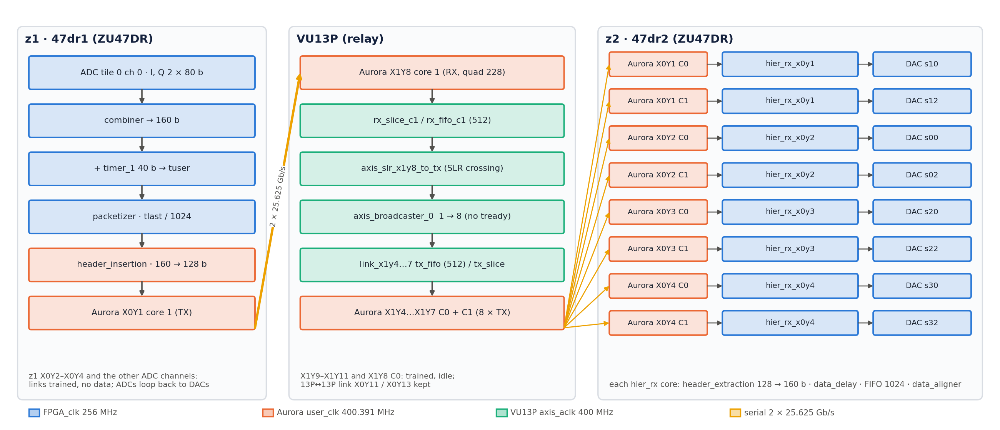

* **One source, eight sinks.** z1 sends ADC tile 0 channel 0 on Aurora X0Y1 core 1. The VU13P receives it on
  X1Y8 core 1, crosses SLRs and duplicates it to all eight Aurora cores of quads 224–227, each linked to one z2 core.
* **Timestamped samples.** Each 160-bit sample (5 I/Q pairs at 256 MHz = 1.28 GSPS complex) is tagged with the z1
  40-bit timer. The timestamp travels in-band as a 64-bit header once per 1024-sample packet, and z2 rebuilds it per beat.
* **Scheduled playback.** z2 adds a programmable delay (`axi_delay`) and releases every sample when its own timer
  reaches that time, so all eight DACs play the stream with a fixed, known latency.
* **Independent links.** The broadcaster has no back-pressure; a stalled or down z2 link loses data on that link only.
* z1 Aurora RX and the z1↔VU13P links on X0Y2–X0Y4 are built and trained but carry no data.

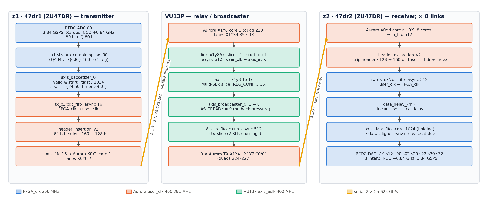

## 3. Serial link allocation

Aurora 64B66B v13.0, **Framing** mode, 2 lanes, **25.625 Gb/s per lane**, no flow control, no CRC, 156.25 MHz
reference clock on MGTREFCLK0 of the own quad. Two cores per quad: core 0 owns the QPLL and user clock, core 1 shares them.

| z1 quad (bank) | z1 lanes C0 / C1 | VU13P quad (bank) | VU13P lanes C0 / C1 | z2 quad (bank) | Use |
|---|---|---|---|---|---|
| X0Y1 (128) | X0Y4-5 / **X0Y6-7** | X1Y8 (228) | X1Y32-33 / **X1Y34-35** | — | **ADC stream (C1)** |
| X0Y2 (129) | X0Y8-9 / X0Y10-11 | X1Y9 (229) | X1Y36-37 / X1Y38-39 | — | link only |
| X0Y3 (130) | X0Y12-13 / X0Y14-15 | X1Y10 (230) | X1Y40-41 / X1Y42-43 | — | link only |
| X0Y4 (131) | X0Y16-17 / X0Y18-19 | X1Y11 (231) | X1Y44-45 / X1Y46-47 | — | link only |
| — | — | X1Y4 (224) | X1Y16-17 / X1Y18-19 | X0Y1 (128) | broadcaster M00 / M01 |
| — | — | X1Y5 (225) | X1Y20-21 / X1Y22-23 | X0Y2 (129) | M02 / M03 |
| — | — | X1Y6 (226) | X1Y24-25 / X1Y26-27 | X0Y3 (130) | M04 / M05 |
| — | — | X1Y7 (227) | X1Y28-29 / X1Y30-31 | X0Y4 (131) | M06 / M07 |

**Reference clock pins** (P / N, from the golden IBERT):

| Board | Quad → pins |
|---|---|
| VU13P | X1Y4 AW9/AW8 · X1Y5 AT11/AT10 · X1Y6 AM11/AM10 · X1Y7 AH11/AH10 · X1Y8 AD11/AD10 · X1Y9 Y11/Y10 · X1Y10 T11/T10 · X1Y11 M11/M10 · (13P↔13P: X0Y11 R36/R37, X0Y13 L36/L37) |
| ZU47DR (z1, z2) | X0Y1 AA33/AA34 · X0Y2 W33/W34 · X0Y3 U33/U34 · X0Y4 P31/P32 |

GT serial pins are placed by the Aurora IP location (no PACKAGE_PIN). Lane pairing C0 ↔ C0 and C1 ↔ C1 is assumed
straight; the golden IBERT confirms the quad pairing only (§12.4).

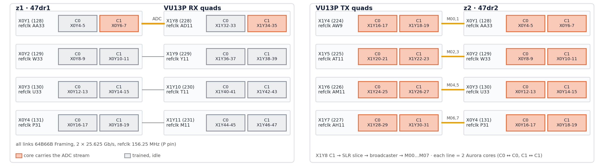

## 4. Clocking

| Clock | Frequency | Source | Users |
|---|---|---|---|
| `FPGA_clk` (z1, z2) | **256 MHz** | board pin `FPGA_clk_p_0` → `util_ds_buf_0` | RFDC AXIS, combiners, packetizer, `timer_1`, container `s_axis_aclk`, `hier_rx`, `data_delay`, `data_aligner` |
| `init_clk` (z1, z2) | 100 MHz | `fpga_clk_100mhz` (AN10) → `util_ds_buf_2` | Aurora `init_clk`, reset logic |
| `pl_clk0` (z1, z2) | 100 MHz | Zynq PS | AXI-Lite (`smartconnect_0`, GPIOs, RFDC `s_axi`, DMA_Ctrl) |
| `PL_SYSREF` (z1, z2) | — | board pin → `util_ds_buf_3` | `pl_sysref_int`, `sync_pulse_to_level_1` (timer start) |
| `sys_clk` (VU13P) | 100 MHz | BA15, DIFF_HSTL_I_18 | Aurora `init_clk`, `clk_wiz_0` input |
| `axis_aclk` (VU13P) | **400 MHz** | `clk_wiz_0/clk_out1` | link FIFOs (fabric side), `axis_slr_x1y8_to_tx`, broadcaster |
| Aurora `user_clk` | ≈ 390 MHz (line rate / 66 per 64-bit lane word) | each quad's core 0 | Aurora user interface, `header_insertion` / `header_extraction`, link slices |
| GT refclk | 156.25 MHz | MGTREFCLK0 of each quad | QPLL |

* **Time base.** z1 and z2 must take `FPGA_clk` from a **common reference**, so their timers count at exactly the
  same rate (§6). The VU13P only relays; its clocks need no relation to z1/z2 because every link has headroom (§11).
* All crossings between `FPGA_clk` / `axis_aclk` and `user_clk` are AXIS data FIFOs with independent clocks (§9.2).
* `pma_rst`: z1/z2 drive `PMA_RST` (LVDS, `util_ds_buf_1` OBUFDS) from `axi_gpio_pma_rst`; the VU13P receives it on
  AU16/AV16 and uses it for the Aurora `pma_init` of all cores.

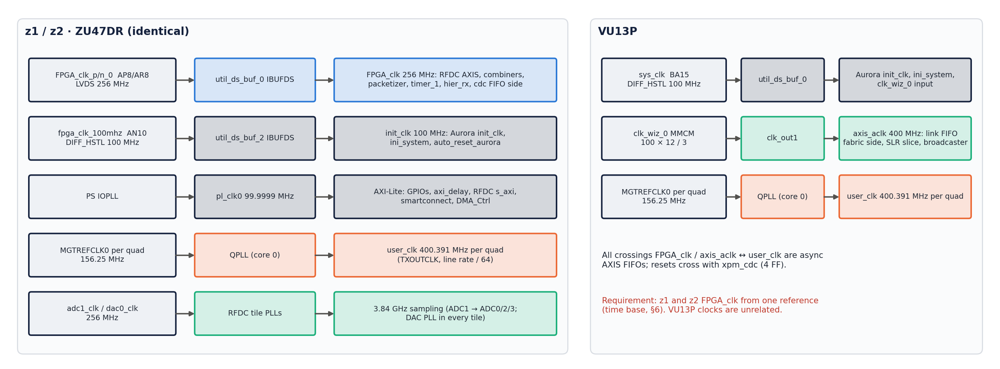

## 5. Data path and format

### 5.1 Sample format
* ADC: RFDC tile 0 ch 0, 3.84 GSPS, ×3 decimation, NCO +0.84 GHz, I/Q mode: `m00_axis` (I) and `m01_axis` (Q),
  80 bits = 5 samples each per 256 MHz clock.
* `axi_stream_combininp_adc00` interleaves them into **160 bits**:
  `{Q4,I4,Q3,I3,Q2,I2,Q1,I1,Q0,I0}` (16 bit each). This is the format the RFDC DAC expects in I/Q mode, so the
  same word drives a DAC directly (z1 loopbacks, z2 outputs).
* DAC: 3.84 GSPS, ×3 interpolation, NCO −0.84 GHz, 160-bit IQ input per channel.

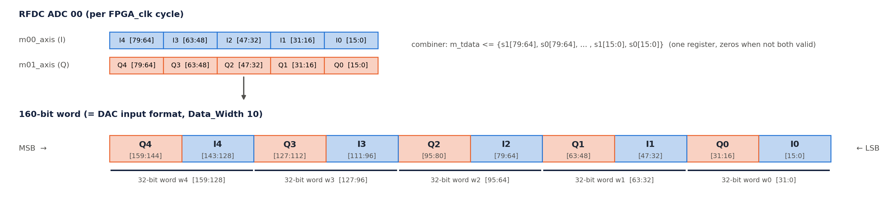

### 5.2 Timestamp and packet
* `timer_1` (40 bit) counts `FPGA_clk` cycles from the start event (§6). `tuser = {24'b0, timer[39:0]}`
  (`ilconcat_1` + `xlconstant_0`).
* `axis_packetizer_0`: valid only after start, `tlast` every **1024 samples** (`PACKET_LENGTH`).

### 5.3 160 → 128 → 160
* `header_insertion_v2` (z1 container, `hier_tx_x0y1/tx_c1`, `user_clk`): at the first beat of a packet it inserts
  the 64-bit header `{ip[15:0], type[7:0], time[39:0]}` = the packet's first `tuser`, then packs the 160-bit samples
  into **128-bit beats** (32-bit word shift register).
  A packet is 64 + 1024 × 160 = 163 904 bits = **1280.5 beats**. The half beat is carried into the next packet, so
  packets alternate between 1281 and 1280 beats and the 64-bit word alignment depends on the previous packet (§10).
* Aurora Framing carries `tlast` across both hops (z1 → VU13P → z2).
* `header_extraction_v2` (z2 container, `hier_rx_x0yN/rx_c<n>`): takes the header from the top 64 bits of the
  first beat after `tlast`, unpacks to 160 bits and outputs **`tuser` = header + beat index** (upper 24 bits 0).
  `err` output (XOR check of the data words) goes to the container ILA.

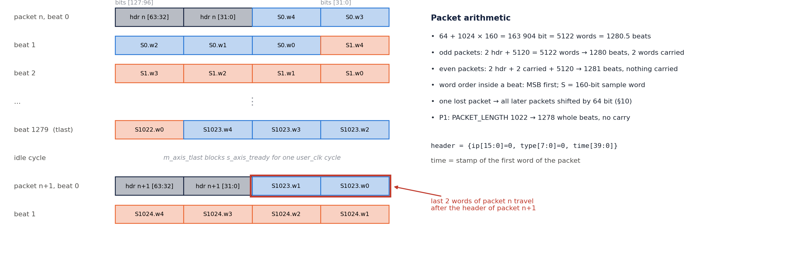

### 5.4 Header overhead
64 bits per 1024 samples = **0.04 %**. With the frame separator and the one-cycle stall per packet in
`header_insertion`, a packet occupies ≈ 1282.5 `user_clk` cycles (§11).

## 6. Time base and timers (whole system)

The system has **one time base, kept by two identical counters**: `timer_1` on z1 and `timer_1` on z2. Both count
256 MHz `FPGA_clk` cycles from the same SYSREF pulse, so at any instant they hold the same value. z1 writes its
timer value into every sample; z2 compares that value (plus a programmable delay) with its own timer and plays the
sample when they meet. The VU13P has no timer: it forwards the time inside the packet header untouched.

### 6.1 Timer hardware (identical on z1 and z2)

| Block | RTL | Function |
|---|---|---|
| `timer_1` | `timer.v` (`TIME_WIDTH = 40`) | `timestamp <= timestamp + 1` every `FPGA_clk` cycle while `start` = 1; cleared by `aresetn` = 0; holds while `start` = 0 |
| `sync_pulse_to_level_1` | `sync_pulse_to_level.v` | `level_ref` (= `start`) goes 1 on the first `pulse_ref` (PL SYSREF) after `rst_n` is released and stays 1 until the next reset |
| `xpm_cdc_gen_1` | XPM sync reset | `axi_gpio_arstn` (PS, `pl_clk0`) → `irstn` on `FPGA_clk`; resets timer, `sync_pulse_to_level`, packetizer (z1), `hier_rx` and `axi_delay` (z2) |
| `util_ds_buf_3` | IBUFDS | board `PL_SYSREF` pin → `pulse_ref` (also to `pl_sysref_int` for RFDC multi-tile sync) |

* Clock: `FPGA_clk` 256 MHz (`util_ds_buf_0`); one count = **3.906 ns**; 40 bits wrap after 2⁴⁰ cycles = **71.6 min**.
* On z1 the same `start` level also enables `axis_packetizer_0`, so the first transmitted sample carries time ≈ 0.
* On z2 the timer value goes to all four `hier_rx_x0yN/timestamp` inputs (all eight aligners use one time).

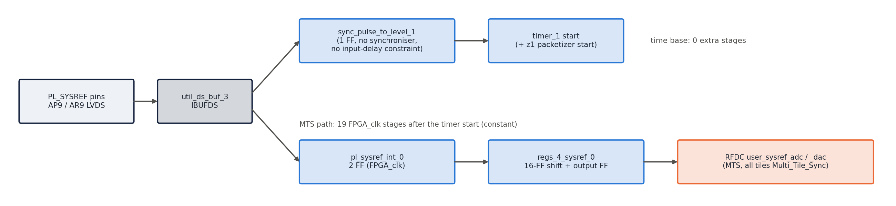

### 6.2 Starting both timers together

1. Hold `arstn` = 0 on both boards (`axi_gpio_arstn` @ 0xA001_0000 = 0): timers at 0, `start` = 0.
2. Release `arstn` on **z2, then z1** (z2 must be ready before z1 sends).
3. Issue **one PL SYSREF pulse** to both boards. On the next `FPGA_clk` edge both `start` levels go 1 and both
   timers count from 0 in the same cycle.

Requirements for the two counters to stay equal:
* **Same frequency:** z1 and z2 `FPGA_clk` must come from one reference. An offset of *x* ppm makes the timers drift
  by *x* × 256 counts per second (100 ppm = 25 600 counts/s); z2 would play samples progressively early or late and
  its holding FIFO overflows in < 50 ms.
* **Same start edge:** SYSREF must reach both boards with a fixed phase to `FPGA_clk` and must be sampled after both
  `arstn` are released. If SYSREF is periodic and one board is released one period later, its timer lags by one
  SYSREF period for the whole run.
* There is no further time correction: the timers are free-running after the start, so any start offset Δ
  (z2 ahead by Δ counts) shortens the effective latency to `delay − Δ`.

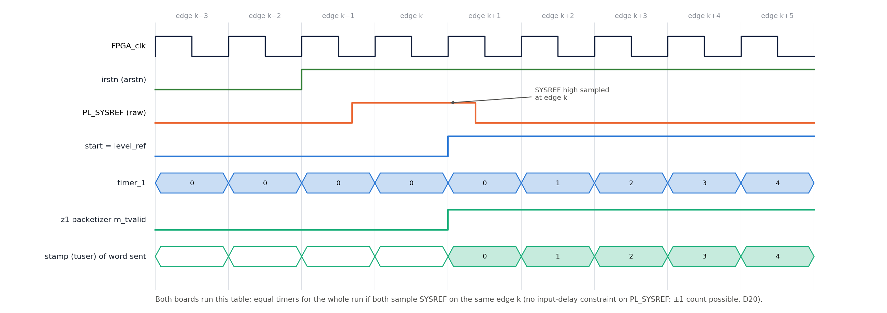

### 6.3 Stamping on z1

* `tuser = {24'b0, timer[39:0]}` (`ilconcat_1`: `In0` = `timer_1/timestamp`, `In1` = `xlconstant_0` = 0) is applied to
  `axis_packetizer_0` in the same cycle as the sample. The combiner registers the RFDC data once, so the time is
  taken one cycle after the ADC word left the RFDC — a constant offset that cancels in the end-to-end latency (§6.7).
* The packetizer passes `tuser` with every sample and asserts `tlast` every 1024 samples.

### 6.4 Carrying the time (z1 → VU13P → z2)

* `header_insertion_v2` sends only the **time of the first sample of each packet**, in the 64-bit header
  `{ip 16, type 8, time 40}` (ip and type are 0). The other 1023 times are implied by their position.
* The VU13P relays 128-bit beats and `tlast` only (`rx_fifo` → SLR slice → broadcaster → `tx_fifo`); it never reads
  or changes the time, and its clocks need no relation to the z1/z2 time base.
* Transport delay (Aurora hops, FIFOs, clock crossings) does not change the time value; it only uses up part of the
  delay budget (§6.7).

### 6.5 Rebuilding the time on z2

* `header_extraction_v2` loads `m_axis_tuser` from the header and adds 1 for every output sample:
  `tuser = header time + sample index`, i.e. every sample gets back the z1 time at which it was stamped.
  (Simulation detail: from the second packet on, the rebuilt `tuser` is one count higher than in the first packet,
  because the last beat of a packet is output after the next header is loaded; the measured DAC latency is still
  constant for every sample, §6.7.)
* `tuser` crosses into `FPGA_clk` with the sample in `rx_c<n>/cdc_fifo` (512 deep, 64-bit `tuser`).

### 6.6 Scheduling and release on z2 (per Aurora core)

**data_delay** — computes the due time:
* `due = time + delay` (40-bit arithmetic, wraps with the timer). `delay` (32 bit) is `axi_delay`
  (0xA008_0000, default 0x200 = 512 counts = 2.0 µs), shared by all eight cores.
* Guard: if the incoming time jumps forward by more than 1024 counts relative to the previous due time, the previous
  due time is kept (protects against a corrupted header; see §10 for its side effect after packet loss).
* Never back-pressures (`s_axis_tready = 1`); output goes into `axis_data_fifo` (1024 deep), which holds the samples
  until they are due.

**data_aligner** — releases at the due time:
* `end_time = z2 timer + 2` (two-cycle pipeline compensation). `sys_time` and `data_time` are 41-bit: the extra MSB
  toggles each time the 40-bit value wraps, so comparisons stay correct across the 71.6-min wrap.
* `out_valid` = `sys_time ≥ data_time` (equal, or later within the same epoch, or the epoch bit differs and the low
  bits are smaller). While `out_valid` = 0 the FIFO is not read and the DAC receives zeros; when 1 the sample is
  read and sent. A late sample (due time already passed) is sent immediately, without waiting.
* ILA probes in each `hier_rx_x0yN`: `timestamp` (z2 timer), `sys_time`, `data_time`, `end_time`.

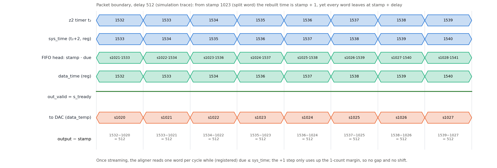

### 6.7 End-to-end latency

A sample captured when the z1 timer reads **T** leaves the z2 aligner when the z2 timer reads **T + delay + 1**
(simulation, every sample, every link, delays 200 and 512). The `+1` is the net of the combiner register, the aligner
`+2` compensation and the aligner output register.

| Quantity | Value (default delay 512) |
|---|---|
| Fixed ADC → DAC latency | (delay + 1) × 3.906 ns = 513 × 3.906 ns = **2.004 µs** |
| Transport latency (z1 packetizer → z2 FIFO) | < delay; measured in simulation well below 512 counts |
| Samples waiting in the z2 holding FIFO | delay − transport latency (simulation: 504 of 1024) |
| Valid `delay` range | transport latency < delay < transport latency + ≈ 1000 |

**Worked example (delay = 0x200 = 512):** SYSREF at t = 0 → both timers 0. A sample stamped T = 1000 on z1 is sent
in the packet that started at T = 0 (header time 0, index 1000). It reaches z2 a few hundred counts later; z2 rebuilds
time 1000, computes due = 1512 and keeps it in the FIFO. When the z2 timer reaches 1512 (sys_time = end_time = 1513
≥ data_time) the aligner reads it and the DAC receives it at z2 time **1513** = 1000 + 512 + 1. All eight z2
outputs release this sample in the same cycle.

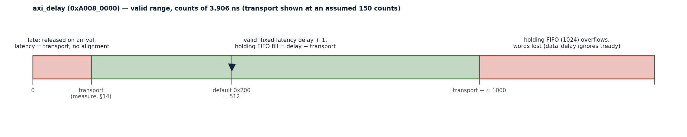

### 6.8 Wrap-around
* Both timers wrap from 0xFF_FFFF_FFFF to 0 in the same cycle (71.6 min after start). `data_delay` wraps `due` the
  same way, and the aligner's epoch bit keeps the ordering. Simulated across the wrap: latency constant, no gaps.

### 6.9 What breaks the time base, and recovery

| Event | Effect | Recovery |
|---|---|---|
| z1 and z2 clocks not from one reference | timers drift; outputs early/late, z2 FIFO overflow | fix the clock tree, restart (§6.2) |
| Boards started on different SYSREF pulses | constant offset of N SYSREF periods | restart with one SYSREF after both `arstn` releases |
| z1 reset / reprogrammed | z1 time restarts low → due times decrease → `data_aligner` epoch bit toggles → z2 outputs zeros, holding FIFO overflows (RTL analysis, rev 0.12) | hold `arstn` on both, restart (§6.2) |
| z2 reset alone | `data_delay` guard freezes the due time at 0 → samples pass through unscheduled (RTL analysis, rev 0.12) | restart both (§6.2) |
| Lost packet / large time jump | see §10 (alignment, `data_delay` guard) | reset both, restart |
| `delay` changed while running | smaller delay: due time decreases → epoch toggles → output stops; larger delay: zeros for the difference, FIFO fill grows (RTL analysis, rev 0.12) | change `delay` only while `arstn` = 0 |

## 7. Board designs

### 7.1 z1 — 47dr1 (transmitter)

| ADC ch (I/Q) | Combiner | Destination |
|---|---|---|
| 00 (m00/m01) | `axi_stream_combininp_adc00` | `axis_packetizer_0` → `S_AXIS_X0Y1_C1` → VU13P |
| 02 | `axi_stream_combininp_adc02` | DAC s02 |
| 10 | `axi_stream_combininp_adc10` | DAC s10 |
| 12 | `axi_stream_combininp_adc12` | DAC s12 |
| 20 | `axi_stream_combininp_adc20` | DAC s20 |
| 22 | `axi_stream_combininp_adc22` | DAC s22 |
| 30 | `axi_stream_combininp_adc30` | DAC s30 |
| 32 | `axi_stream_combininp_adc32` | DAC s32 |

DAC s00 and the z1 Aurora RX outputs are unused. Removed (R7): PARAM_RECORDER (with its GPIOs, CDC and broadcaster;
PS HP0/HP1 disabled), phase_calibration, pulse generator, debug VIOs (resets now from AXI GPIO).

### 7.2 VU13P (relay)
* Container `aurora_gty_vu13pto47dr`: for each quad X1Y4…X1Y11 a `hier_x1yN` (2 Aurora cores, status VIOs, reset
  helpers) and an identical `link_x1yN` (R9):
  TX `S_AXIS_TX_C<n>` → `tx_fifo_c<n>` (512, `axis_aclk` → `user_clk`) → `tx_slice_c<n>` (Multi-SLR crossing) → core;
  RX core → `rx_slice_c<n>` → `rx_fifo_c<n>` (512, `user_clk` → `axis_aclk`) → `M_AXIS_RX_C<n>`.
* Top: `M_AXIS_X1Y8_C1` → `axis_slr_x1y8_to_tx` (Multi-SLR crossing; quad 228 and quads 224–227 are in different
  SLRs, D11) → `axis_broadcaster_0` (8 × 128 b, **no tready**, D12) → `S_AXIS_X1Y4_C0` … `S_AXIS_X1Y7_C1`.
* `system_ila_0` in the container monitors X1Y4 (core 0 RX, core 0/1 TX).
* Core-1 link reset (`hier_x1yN/aurora_rstn_1`) follows `aurora_x1yN_1/channel_up` since rev 0.12 (D19; it followed core 0
  `lane_up` before, inherited from EV1 `hier_x1y4`).
* 13P↔13P container (`aurora_gty_vu13ptovu13p`, X0Y11/X0Y13) kept; not part of the 1R8T path.

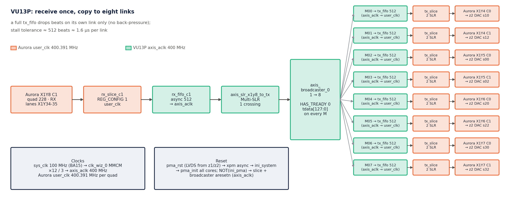

### 7.3 z2 — 47dr2 (receiver, 8 DACs)

| Container port | `hier_rx` | DAC |
|---|---|---|
| `M_AXIS_X0Y1_C0` / `_C1` | `hier_rx_x0y1` | s10 / s12 |
| `M_AXIS_X0Y2_C0` / `_C1` | `hier_rx_x0y2` | s00 / s02 |
| `M_AXIS_X0Y3_C0` / `_C1` | `hier_rx_x0y3` | s20 / s22 |
| `M_AXIS_X0Y4_C0` / `_C1` | `hier_rx_x0y4` | s30 / s32 |

* `hier_rx_x0yN`: per core `data_delay_<n>` → `axis_data_fifo_<n>` (1024) → `data_aligner_<n>`, ILAs on the
  delay/aligner times. DAC tile 3 is configured like tile 2.
* AXI map (`/zynq_ultra_ps_e_0/Data`): DMA_Ctrl 0xA000_0000, `axi_gpio_arstn` 0xA001_0000, `axi_gpio_pma_rst`
  0xA002_0000, `axi_intc_0` 0xA003_0000, RFDC 0xA004_0000 (256 K), **`axi_delay` 0xA008_0000**.
* Removed (R7 and user edits 2026-10-14): PARAM_RECORDER, phase_calibration, unused ADC combiners, top-level TX
  generators, pulse generator, phase-cal and debug VIOs.

## 8. Naming (rev 0.8)

Every name is derived from what it connects to (quad, Aurora core, direction). Generated and checked by
`scripts/naming/gen_container.py` and `gen_top.py`, applied by `apply_container.tcl` / `apply_top.tcl` (`lib.tcl`).

| Level | Name | Example |
|---|---|---|
| GT ports | `GT_SERIAL_TX_<QUAD>_C<n>`, `GT_SERIAL_RX_<QUAD>_C<n>` (n = Aurora core) | `GT_SERIAL_TX_X0Y1_C1` |
| Container data ports | `S_AXIS_<QUAD>_C<n>` → TX of core n; `M_AXIS_<QUAD>_C<n>` ← RX of core n | `M_AXIS_X1Y8_C1` |
| `hier_<quad>` pins | `GT_SERIAL_TX/RX_C<n>`, `S_AXIS_TX_C<n>`, `M_AXIS_RX_C<n>`, `GT_REFCLK`, `arstn_c<n>`, `pma_init`, `user_clk_out` | `hier_x1y4/GT_REFCLK` |
| TX / RX / link pins | `S/M_AXIS_TX_C<n>`, `S/M_AXIS_RX_C<n>`, `user_clk` (Aurora), `axis_aclk` (fabric), `arstn_c<n>` | `link_x1y8/M_AXIS_RX_C1` |
| Per-core cells | `tx_c<n>`, `rx_c<n>`, `tx_fifo_c<n>`, `tx_slice_c<n>`, `rx_slice_c<n>`, `rx_fifo_c<n>`, `user_rst_sync_c<n>`, `axis_rst_sync_c<n>`, `cdc_fifo`, `in_fifo`, `out_fifo` | `link_x1y4/tx_fifo_c0` |
| Wires | driver name: `<cell>_<pin>`, or the input port / hierarchy pin that drives it | `rx_fifo_c1_M_AXIS` |
| RF ports | converter pin | `vout02` = DAC tile 0 ch 2 |
| Unchanged | refclk / board ports (XDC), Aurora core cells `aurora_<quad>_<n>`, `hier_<quad>`, container instances, AXI peripherals (address map) | |

Errors removed by the pass: `S_AXIS_X0Y1` fed core 1 (`_1` fed core 0) in every quad and on the 13P↔13P link;
`GT_SERIAL_TX_3` was core 0; every VU13P refclk pin was `gt_x1y8_diff_ref`; every `link_x1yN` pin said `x1y4`;
wires named after other quads (`aurora_x0y4_*` inside `hier_x0y1`, `hier_x0y13_*`, `rxq3_*`); `s_axis_axlk`;
z2 port `vout01` was DAC ch 2. Checks: 144/144 container ports equal their traced quad/core; net and endpoint
counts identical before/after; all BDs validate; all XDC ports present in the wrappers.

## 9. Flow control, CDC and reset

### 9.1 Flow control
Back-pressure exists only between `header_insertion` and the z1 Aurora TX, inside the VU13P TX path
(`tx_fifo` → Aurora TX) and between `header_extraction` and its FIFOs. Four points **ignore `tready`**, so their
FIFO must never fill:

| Point | Ignores tready | Protected by |
|---|---|---|
| z1 RFDC / combiner → packetizer | yes | z1 `tx_c1/cdc_fifo` (16) + link headroom |
| Aurora RX (VU13P, z2) | yes (Aurora has no RX back-pressure) | `rx_fifo` (512) / `in_fifo` (512) |
| VU13P broadcaster | yes (D12) | `tx_fifo_c<n>` (512) per link |
| z2 `data_delay` | yes (`s_axis_tready = 1`) | `hier_rx` FIFO (1024) and the delay constraint (§6.7) |

### 9.2 CDC inventory

| Signal | From → To | Method |
|---|---|---|
| z1 samples + tuser | `FPGA_clk` → `user_clk` | `tx_c<n>/cdc_fifo` (axis_data_fifo, independent clocks, 16) |
| VU13P RX stream | `user_clk` (228) → `axis_aclk` | `rx_fifo_c<n>` (512) |
| VU13P TX stream | `axis_aclk` → `user_clk` (224–227) | `tx_fifo_c<n>` (512) |
| z2 samples + tuser | `user_clk` → `FPGA_clk` | `rx_c<n>/cdc_fifo` (512) |
| Aurora channel-up reset | `user_clk` ↔ `axis_aclk` / `FPGA_clk` | `xpm_cdc_gen` async reset (`user_rst_sync_c<n>`, `axis_rst_sync_c<n>`) |
| `arstn`, `pma_rst` GPIO | `pl_clk0` → `FPGA_clk` / `init_clk` | `xpm_cdc_gen` sync reset (`xpm_cdc_gen_0/1`) |
| Aurora TX out clocks | async to `sys_clk` / board clocks | `set_clock_groups -asynchronous` in the XDC |

### 9.3 FIFO budget (rev 0.9)

| FIFO | Depth | Peak fill, normal | Peak fill, 1 µs VU13P TX stall | Peak fill, 3 µs stall |
|---|---|---|---|---|
| z1 `tx_c1/cdc_fifo` | 16 | 1 | 1 | 1 |
| z1 `tx_c1/out_fifo` | 16 | 4 | 4 | 4 |
| VU13P `rx_fifo_c1` | 512 | 1 | 1 | 1 |
| VU13P `tx_fifo_c<n>` | 512 | 4 | **321** | **512 (overflow, 450 beats lost)** |
| z2 `rx_c<n>/in_fifo` | 512 | 1 | 1 | 1 |
| z2 `rx_c<n>/cdc_fifo` | 512 | 6 | 259 | 411 |
| z2 `hier_rx` FIFO | 1024 | 504 (= delay) | 504 | 1024 (overflow) |

`scripts/sim_chain/run_fifo.sh <stall_ns> [txdepth]`: real RTL (`axis_packetizer`, `header_insertion_v2`,
`header_extraction_v2`, `data_delay`, `data_aligner`, `timer`), real FIFO depths, Aurora TX model with the 64b/66b
gearbox pause (1 in 33), clock compensation (3 cycles in 5000) and one separator cycle per frame, three independent
user clocks and the 400 MHz VU13P fabric clock.
**Result:** no data loss and constant latency in normal operation and with a 1 µs stall of a VU13P TX link.
VU13P TX stall tolerance ≈ 512 beats ≈ **1.6 µs**. The z1 TX FIFOs (16) peak at 4 because the link has 17 % headroom;
64-deep z1 FIFOs change nothing.

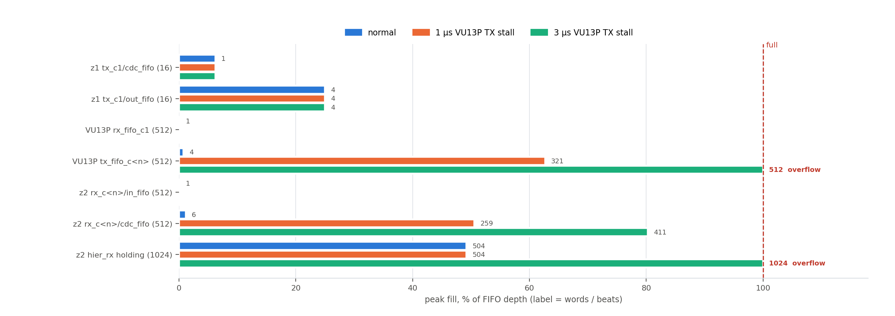

### 9.4 Reset
* `arstn` (AXI GPIO → `xpm_cdc_gen_1`) resets the timer, `sync_pulse_to_level`, packetizer (z1) and `hier_rx` /
  `axi_delay` (z2). `pma_rst` (AXI GPIO → `xpm_cdc_gen_0`) drives `ini_system` → `pma_init` of all Aurora cores and
  the `PMA_RST` LVDS output.
* Each Aurora core's `aurora_rstn` derives a link reset from `channel_up`; it is synchronised into `user_clk` and
  `axis_aclk` / `FPGA_clk` and resets that core's FIFOs and slices. A link that is down drops its data.

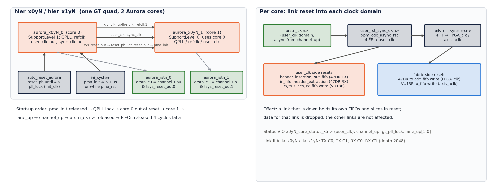

## 10. Error handling and recovery

* There is **no retransmission**. Aurora Framing without CRC delivers frames as received.
* **Lost packet:** because of the carried half beat (§5.3) one lost packet shifts the 64-bit word alignment of every
  later packet → wrong data on that z2 output until reset. Simulation: `PACKET_LENGTH = 1022` (64 + 1022 × 160 bits =
  1278 whole beats) makes packets independent; a lost packet then only zeroes its own samples (Open item P1).
* **Timestamp jump** > `delay + 1024` (≥ 2 lost packets): `data_delay` keeps the previous time and the output stops
  until reset (P2).
* **Link down / late link-up:** the VU13P drops that link's data; when the link comes up mid-stream, z2 must be reset
  (or P1 applied) to resynchronise to a packet start.
* **Clock / SYSREF error:** see §6.2 and §6.9; recovery = reset both boards and restart on a common SYSREF.

## 11. Performance

| Step | Value |
|---|---|
| ADC payload | 160 b × 256 MHz = **40.96 Gb/s** (1.28 GSPS complex, 16-bit I/Q) |
| Header | 64 b / 1024 samples = +0.04 % |
| Link beats per packet | 1280.5 + 1 separator + 1 header stall ≈ **1282.5 per 4.0 µs** |
| Link payload capacity | 2 × 25.625 Gb/s × 64/66 = **49.7 Gb/s** ≈ 1553 beats per 4.0 µs; clock compensation ≈ 0.06 % |
| **Link utilisation** | **≈ 82.6 %** (17 % headroom) |
| VU13P fabric | 128 b × 400 MHz = 51.2 Gb/s (above the link, RX FIFO never fills) |
| End-to-end latency | `delay + 1` cycles of 256 MHz (default 513 cycles = 2.0 µs) |

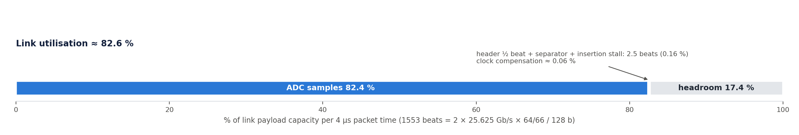

## 12. Verification, limitations and future work

### 12.1 End-to-end simulation (`scripts/sim_chain/run.sh <delay> [wrap] [lost_packets] [packet_length]`)
Real RTL of the whole chain, two Aurora hops with back-pressure gaps, three independent user clocks.

| Test | Result (rev 0.7) |
|---|---|
| delay 512 | PASS — every sample at the DAC exactly `delay + 1` cycles after its z1 timestamp, no gaps, no drops |
| delay 200 | PASS — same |
| delay 1400 | FAIL as expected — 1024-deep holding FIFO overflows (constraint §6.7) |
| 40-bit wrap | PASS — latency constant through 0xFF_FFFF_FFFF → 0 |
| 1 lost packet | FAIL — word misalignment until reset (§10); PASS with `PACKET_LENGTH = 1022` (1 packet of zeros) |
| 2 lost packets | FAIL — `data_delay` guard freezes the time (§10) |

### 12.2 FIFO budget (`scripts/sim_chain/run_fifo.sh`) — rev 0.9, see §9.3.

### 12.3 Block-design checks
* `validate_bd_design` clean on all BDs (rev 0.8).
* RFDC: z1 ADC and z2 DAC configurations match (3.84 GSPS, ×3, 1.28 GSPS complex, NCO ±0.84 GHz).
* All Aurora cores: Framing, 25.625 Gb/s, 2 lanes, start lanes as in §3.

### 12.4 Not yet done
* Hardware bring-up (§15).
* Lane-level pairing C0/C1 between boards is assumed straight; verify with the IBERT or the core status VIOs.

### 12.5 Known limitations / possible fixes
* P1 `PACKET_LENGTH = 1022` (packet = whole beats).
* P2 `data_delay` guard: resynchronise on a large timestamp jump instead of freezing.
* `data_delay.v` line 66 keeps `s_axis_tuser[24]` instead of `[63:40]` (harmless: upper bits are 0).
* VU13P methodology TIMING-4/27 on `clk_wiz_0/clk_in1` (inherited).

### 12.6 Implementation results (VU13P build #6 rev 0.12; z1 / z2 build #5 rev 0.11; Vivado 2025.2)

| | VU13P · relay | z1 · 47dr1 | z2 · 47dr2 |
|---|---|---|---|
| Setup slack (WNS) | **+0.011 ns** (rev 0.11: +0.025) | **+0.008 ns** | **+0.023 ns** |
| Hold slack (WHS) | +0.010 ns | +0.010 ns | +0.010 ns |
| Failing endpoints | 0 | 0 | 0 |
| GT channels | 40 (X1Y16–X1Y47 + X0Y44–47, X0Y52–55) | 16 (X0Y4–X0Y19) | 16 (X0Y4–X0Y19) |
| Refclk pins | = golden (AW9 AT11 AM11 AH11 AD11 Y11 T11 M11, R36 L36) | = golden (AA33 W33 U33 P31) | = golden |
| LUT / FF / BRAM | 3.3 % / 4.7 % / 18.4 % | 14.7 % / 10.1 % / 20.8 % | 21.3 % / 16.1 % / 46.9 % |
| DRC | warnings only (PDCN-1569, RTSTAT-10) | same | same |
| Methodology critical | TIMING-4/27 on `clk_wiz_0/clk_in1` (inherited) | none | none |
| Bitstream + probes | `vu13p.runs/impl_1/aurora_gty_vu13p_rst_wrapper.bit` + `.ltx` | `47dr1.runs/impl_1/design_1_wrapper.bit` + `.ltx` | `47dr2.runs/impl_1/design_1_wrapper.bit` + `.ltx` |
| XSA (with bitstream) | — (no PS) | `47dr1/z1_47dr1.xsa` | `47dr2/z2_47dr2.xsa` |

Reports: `<project>/reports/` (timing_summary, utilization, drc, methodology, clock_interaction, cdc, gt_placement).
BRAM rose with the 2048-deep link ILAs (§17). Build #4 (no ILAs) had z1/z2 failing only the two MTS crossings
(−1.414 / −2.049 ns), the same as the original `47DR_integrated_3` project → D16.

## 13. Decision log (append-only)

| ID | Rev | Decision | Rationale | Status |
|---|---|---|---|---|
| D1 | 0.1 | Full copy of the EV1 integrated projects into three new projects. | User choice; originals stay untouched. | Active |
| D2 | 0.1 | 47DR part `xczu47dr-ffvg1517-2-i` (was -2-e), IP upgraded. | Matches the golden IBERT boards. | Active |
| D3 | 0.1 | Vivado 2025.2. | User tool. | Active |
| D4 | 0.1 | 1R8T: z1 one 2-lane Aurora → VU13P → broadcast to eight 2-lane Auroras → z2, one DAC per core. | User architecture (R4, R5). | Active |
| D5 | 0.2 | z1 keeps 8 cores on X0Y1–X0Y4; VU13P mirrors them with 8 RX cores on quads 228–231. | User (R6); every z1 lane pair has a partner. | Active |
| D6 | 0.3 | Remove PARAM_RECORDER and phase_calibration in z1 and z2; DACs fed directly. | User (R7). | Active |
| D7 | 0.4 | ADC stream on z1 X0Y1 **core 1**; VU13P broadcaster from X1Y8 core 1. | User option (b), confirmed again in rev 0.8 after a GUI edit had moved it to core 0. | Active |
| D8 | 0.5 | Remaining z1 ADC channels loop back to the same-index DAC. | User (R8). | Active |
| D9 | 0.5 | All links identical: VU13P `link_x1yN` = copy of the X1Y4 plumbing; 47DR quads with identical TX/RX wiring. | User (R9). | Active |
| D10 | 0.6 | Build with `XILINX_LOCAL_USER_DATA=no`; delete only `phase_calibration_inst_*` / `PARAM_RECORDER_inst_*` stale filesets. | Parallel runs crashed with SIGBUS; a broader cleanup deleted a live container fileset and crashed Vivado. | Active |
| D11 | 0.6 | Multi-SLR register slice `axis_slr_x1y8_to_tx` before the broadcaster. | −0.116 ns on 400 MHz inter-SLR paths (quad 228 vs 224–227). | Active |
| D12 | 0.1 | Broadcaster without `tready`. | A stalled or down z2 link must not stop the others. | Active (FIFO budget §9.3) |
| D13 | 0.7 | `axi_delay` AXI GPIO (32 bit, default 0x200) replaces `vio_data_delay`; address 0xA008_0000. | User edit; software-controlled latency. | Active |
| D14 | 0.8 | Connectivity-derived naming at every level (§8), tool-generated and checked. | User (R13); old names were misleading (core swaps, wrong quads). | Active |
| D15 | 0.9 | Keep FIFO depths (z1 16/16, VU13P 512/512, z2 512/512/1024). | Simulation: no loss with 17 % link headroom; VU13P TX tolerates 1.6 µs stalls. | Active |

| D16 | 0.11 | False path `hier_mts/sysref_trig_det_*/waitsysref` → `sync_out_latch_*/waitforsysref_d1` + `ASYNC_REG` on d1/d2 (47DR XDC). | `FPGA_clk` → RFDC ADC0/DAC0 clocks are unrelated; the 4-flop synchroniser is the real CDC; Vivado timed it with a 0.03 ns requirement (failed in the original project too). | Active |
| D17 | 0.11 | Debug ILAs on every link: `ila_x0yN` (47DR container), `ila_x1yN` + `ila_bcast` (VU13P), ADC slot on z1 `system_ila_1`; resets left open. | User request: monitor the data traffic for debug on every hop. | Active |
| D18 | 0.11 | Remove all sources not used by the tops (old BDs `aurora.bd`, `aurora_gty_rst_47dr.bd`, PARAM_RECORDER, phase_calibration, standalone IPs, ~40 RTL files per 47DR project). | User request; stale entries had crashed / broken three builds. Backup `backup/pre_cleanup_20261014.tgz`. | Active |
| D19 | 0.12 | VU13P `hier_x1yN/aurora_rstn_1/channel_up` driven by core 1 `channel_up` (was core 0 `lane_up`) in all eight quads. | Inherited from EV1 `hier_x1y4`, copied to all quads by D9; core-1 FIFOs must follow their own link. Backup `backup/pre_rstn_fix_20261014.tgz`. | Active |
| D20 | 0.12 | PL_SYSREF input-delay constraint not added (TIMING_SYNC T1). | User decision. | Active |
**Proposed (not yet decided):** P1 `PACKET_LENGTH = 1022`; P2 resynchronising `data_delay` guard; P3 fixed bring-up
sequence (§15).

## 14. Revision history (append-only)

| Rev | Date | Author | Changes |
|---|---|---|---|
| 0.1 | 2026-10-13 | Claude Code (for johnny@jxense.com) | Projects created from the EV1 integrated designs (D1–D3); part change, IP upgrade, local IP repo; first 1R8T pass (D4). |
| 0.2 | 2026-10-13 | Claude Code (for johnny@jxense.com) | z1 keeps 8 Aurora cores on X0Y1–X0Y4; VU13P `hier_x1y8` rebuilt with 2 cores, `hier_x1y9`–`x1y11` added, refclks 229–231 (D5). |
| 0.3 | 2026-10-13 | Claude Code (for johnny@jxense.com) | PARAM_RECORDER and phase_calibration removed (D6); DAC s10/s12 fed from `hier_rx_x0y1`. |
| 0.4 | 2026-10-13 | Claude Code (for johnny@jxense.com) | 47DR container: X0Y3/X0Y4 `hier_tx`/`hier_rx` visible like X0Y1/X0Y2; broadcaster source X1Y8 core 1 (D7). |
| 0.5 | 2026-10-13 | Claude Code (for johnny@jxense.com) | z1 ADC loopbacks (D8); all links uniform on VU13P and 47DR (D9); z2 `hier_rx_x0y2..4` copies, DAC tile 3. |
| 0.6 | 2026-10-14 | Claude Code (for johnny@jxense.com) | Builds #1–#3: SIGBUS fix, stale filesets (D10), X1Y5–7 refclks restored, SLR-crossing slice (D11). VU13P bitstream: WNS +0.026 / WHS +0.010 ns, GT/refclk = golden. 47DR runs stopped on a build-script bug (fixed). |
| 0.7 | 2026-10-14 | Claude Code (for johnny@jxense.com) | User GUI edits reviewed (z2 cleanup, `axi_delay`, 32-bit `data_delay` input). End-to-end RTL simulation added (`scripts/sim_chain/run.sh`): timing exact, 40-bit wrap clean; limits found (packet loss, delay range). |
| 0.8 | 2026-10-14 | Claude Code (for johnny@jxense.com) | Broadcaster back on X1Y8 core 1 (D7); `axi_delay` address (D13); full naming pass on all BDs (D14), backup `backup/pre_naming_20261014.tgz`. |
| 0.9 | 2026-10-14 | Claude Code (for johnny@jxense.com) | FIFO depths read from Vivado; FIFO budget simulation with real depths and Aurora pause model (`run_fifo.sh`), D15. This document, `docs/DESIGN.docx` and `docs/pj22045_1r8t_design.pptx`. |
| 0.10 | 2026-10-14 | Claude Code (for johnny@jxense.com) | Doc only, per user: §6 rewritten as *Time base and timers (whole system)* — timer hardware, start procedure and requirements, stamping on z1, transport, rebuild on z2, `data_delay` / `data_aligner` scheduling, end-to-end latency with a worked example, wrap-around, failure modes. Deck: two new time-base slides (8, 9). |
| 0.11 | 2026-10-14 | Claude Code (for johnny@jxense.com) | Build #4/#5. Fixes on the way: stale `phase_calibration` BlockSrcs fileset (deleting it crashed Vivado; removed from `.xpr` and the generated `design_1.bxml`), missing container IP runs (`build.tcl` now runs `generate_target` + `create_ip_run`), MTS CDC false path (D16). Debug ILAs on every link (D17, §17). All three bitstreams: timing met, GT/refclk = golden (§12.6). Unused sources removed (D18). |
| 0.12 | 2026-10-14 | Claude Code (for johnny@jxense.com) | Docs `SIGNAL_TRANSMISSION.md/.docx` and `TIMING_SYNC.md/.docx` (every module and IP configuration, time base); ASCII diagrams replaced by generated figures (`scripts/docs/make_figs.py`, `docs/fig/`) in all three documents. D19: VU13P core-1 link reset on its own `channel_up` (`scripts/mod13_vu13p_rstn.tcl`), VU13P rebuilt (WNS +0.011 / WHS +0.010 ns, GT placement unchanged). D20: no PL_SYSREF input-delay constraint (user). §6.9 failure rows corrected from RTL analysis; §15 `err` note corrected. |

## 15. Bring-up procedure (three boards)

1. Build all three projects (`scripts/run_build.sh vu13p|47dr1|47dr2`), program the VU13P, then z1 and z2, each with
   its own `.bit` + `.ltx`.
2. Hold `arstn` low on z1 and z2 (`axi_gpio_arstn` = 0). Pulse `axi_gpio_pma_rst` if a link does not come up.
3. Check `channel_up` / `lane_up` on the core-status VIOs (`x0yN_core_status_<n>`, `x1yN_core_status_<n>`): VU13P
   X1Y8 C1 and X1Y4–X1Y7 C0/C1, z2 X0Y1–X0Y4 C0/C1.
4. Write `axi_delay` on z2 (0xA008_0000, default 0x200). It must exceed the path latency and stay below ≈ 1000 + latency.
5. Release `arstn` on **z2 first, then z1**, then issue **one SYSREF** seen by both boards; both timers start
   together and z1 starts sending.
6. ILAs (§17): z1 `ila_x0y1`, VU13P `ila_x1y8` / `ila_bcast`, z2 `ila_x0yN` follow the stream link by link. On z2, the `hier_rx` ILAs show `data_time` and `sys_time`: once running, every output sample should leave exactly
   when `sys_time` = `data_time`. (`header_extraction` `err` is a test-pattern check and is not meaningful for ADC
   data — `SIGNAL_TRANSMISSION.md` §4.4.)
7. Re-sync rule: after any link drop or board reset, hold `arstn` on both boards and repeat steps 5–6.

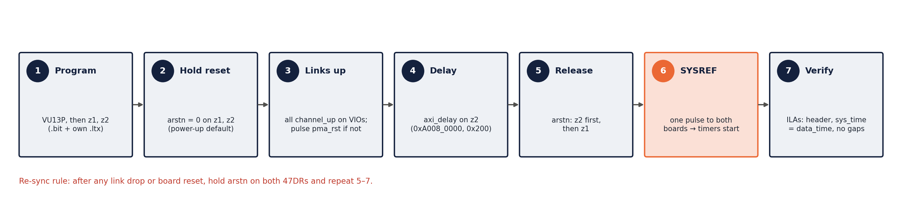

## 16. Scripts

| Script | Purpose |
|---|---|
| `scripts/run_build.sh <proj> [jobs]` → `build.tcl` | clear container caches, synth → impl → bitstream, reports in `<proj>/reports/` |
| `scripts/sim_chain/run.sh`, `run_fifo.sh` | end-to-end and FIFO-budget simulations (xsim) |
| `scripts/naming/*` | naming generator / apply / checks (§8) |
| `scripts/check/fifo_report.tcl` | read-only list of every FIFO / slice / Aurora configuration |
| `scripts/mod*.tcl`, `fix*.tcl`, `fin*.tcl` | historical BD edit passes (rev 0.1–0.8), see `DESIGN_NOTES.md` |
| `scripts/docs/make_ppt.py` | builds `docs/pj22045_1r8t_design.pptx` (template: the reference deck in `~/Downloads/serdes_selecio_axis/docs`) |
| `scripts/mod12_add_ila.tcl` | debug ILAs on every link (§17) |
| `scripts/export_xsa.tcl` | XSA export (§18) |
| `scripts/release/make_release.sh` | release package (§18) |
| `scripts/check/unused_sources.tcl`, `scripts/cleanup/*` | list / remove sources not used by the tops (D18) |
| `scripts/docs/make_docx.py [NAME]` | builds `docs/<NAME>.docx` (DESIGN, SIGNAL_TRANSMISSION, TIMING_SYNC) from the markdown; embeds `` figures and two deck slides |
| `scripts/docs/make_figs.py` | draws all figures into `docs/fig/` (needs matplotlib) |
| `scripts/mod13_vu13p_rstn.tcl` | rev 0.12 core-1 link-reset fix (D19) |

## 17. Debug ILAs (rev 0.11)

Every link has an ILA on its Aurora user interface, so the traffic can be followed from the z1 ADC to every z2 DAC.
All are `system_ila` in INTERFACE (AXIS monitor) mode; resets are left open so they keep capturing while a link is
down. Added by `scripts/mod12_add_ila.tcl`.

| Board | ILA | Clock | Slots (AXIS) | Depth | Shows |
|---|---|---|---|---|---|
| z1 | `system_ila_1` (top) | `FPGA_clk` 256 MHz | 0: `axis_packetizer_0/m_axis` (160 b + tuser + tlast); 1: `axi_stream_combininp_adc00/m` (ADC 160 b) | 1024 | ADC samples and their timestamps before the link |
| z1, z2 | `ila_x0y1` … `ila_x0y4` (container) | quad `user_clk_out` | 0/1: TX C0/C1 into the core (`hier_tx_x0yN/M_AXIS_TX_C0/C1`); 2/3: RX C0/C1 out of the core (`hier_x0yN/M_AXIS_RX_C0/C1`) | 2048 | 128-bit link traffic incl. header beats and `tlast`; z1 ADC stream = `ila_x0y1` slot 1 |
| z1, z2 | `hier_rx_x0y1/rx_c0/system_ila_0` (container, kept) | quad 1 `user_clk` | Aurora RX → `in_fifo` → `header_extraction` (in/out) + `header`, `err` | 1024 | header decode on quad 1 core 0 |
| z2 | `hier_rx_x0yN/system_ila_0/1` (kept) | `FPGA_clk` | per core: `data_delay` in/out, FIFO out, aligner out + `timestamp`, `sys_time`, `data_time`, `end_time` | 1024 | scheduling and release of every DAC sample (§6) |
| z2 | `system_ila_0` (top, kept) | `FPGA_clk` | DAC `s00_axis` | 1024 | one DAC input |
| VU13P | `ila_x1y4` … `ila_x1y11` (container) | quad `user_clk_out` | 0/1: TX C0/C1 into the core (`link_x1yN/M_AXIS_TX_C0/C1`); 2/3: RX C0/C1 (`hier_x1yN/M_AXIS_RX_C0/C1`) | 2048 | ADC stream received on `ila_x1y8` slot 3; the eight outputs on `ila_x1y4..7` slots 0/1 |
| VU13P | `ila_bcast` (top) | `axis_aclk` 400 MHz | 0: broadcaster input (`axis_slr_x1y8_to_tx/M_AXIS`); 1–8: `axis_broadcaster_0/M00..M07_AXIS` | 1024 | the 1 → 8 copy; `tready` = 0 on an output means that link's TX FIFO is full (data lost) |

The previous VU13P container ILA (`system_ila_0`, X1Y4 only) is replaced by `ila_x1y4`.

**Typical checks**
* z1 `ila_x0y1` slot 1: first beat after `tlast` carries the header `{ip 0, type 0, time}` in bits [127:64].
* VU13P `ila_x1y8` slot 3 shows the same beats; `ila_bcast`: all `M0x` `tvalid` follow the input, `tready` stays 1.
* z2 `ila_x0yN` slots 2/3 show the same beats again on every quad; `hier_rx` ILAs: `sys_time` = `data_time` when a
  sample leaves (§6.6).
* Trigger on `tlast` to align a capture to a packet start (one packet = 1280.5 beats, fits in 2048).

## 18. Release package (rev 0.12)

`PJ22045_1R8T_release_rev0.12_20261014.tar.gz` in the project root (52 MB, 1843 files, SHA256-checked), made by
`scripts/release/make_release.sh 0.12`: VU13P bitstream from build #6 (D19), z1 / z2 from build #5, all three documents
with `docs/fig/`. The rev 0.11 package (`…rev0.11_20261014.tar.gz`) is kept for reference.

| Folder | Content |
|---|---|
| `bitstreams/` | `vu13p.bit`/`.ltx`, `z1_47dr1.bit`/`.ltx`, `z2_47dr2.bit`/`.ltx` (load each `.bit` with its own `.ltx`) |
| `xsa/` | `z1_47dr1.xsa`, `z2_47dr2.xsa` (`write_hw_platform -fixed -include_bit`) |
| `docs/` | `DESIGN`, `SIGNAL_TRANSMISSION`, `TIMING_SYNC` (`.md` + `.docx`), `fig/`, `pj22045_1r8t_design.pptx`, `DESIGN_NOTES_<project>.md` |
| `reports/<project>/` | timing summary, utilization, DRC, methodology, clock interaction, CDC, GT placement |
| `source/` | `<project>.xpr` + `<project>.srcs` (+ `ip_repo` for the 47DR projects), `scripts/` — open the `.xpr` and run `scripts/run_build.sh <project>` to rebuild |
| `README.md`, `SHA256SUMS` | contents, versions, results, checksums |

Before packaging, the working tree was cleaned of old logs, crash dumps, superseded reports, Vivado temp folders and
simulation build products; `backup/` (pre-naming / pre-ILA / pre-cleanup snapshots) stays in the working tree only.
