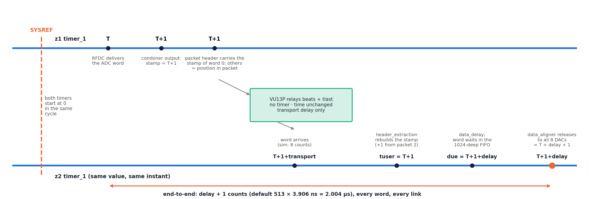

# PJ22045.0.1 1R8T — Timing Synchronisation

| | |
|---|---|
| Project | Folder `~/Desktop/PJ22045.0.1`: `47dr1` (**z1**, ADC transmitter), `vu13p` (relay), `47dr2` (**z2**, 8-DAC receiver). System document: `docs/DESIGN.md` (rev 0.11); signal path: `docs/SIGNAL_TRANSMISSION.md` |
| Scope | The system time base and the scheduled playback: clocks and SYSREF, the two timers, how they are started together, how every sample is stamped on z1, carried, rebuilt on z2, delayed and released to the DACs; latency, alignment of the eight outputs, wrap-around, failure modes, bring-up measurements |
| Data source | RTL of `timer.v`, `sync_pulse_to_level.v`, `axis_packetizer.v`, `header_insertion_v2.v`, `header_extraction_v2.v`, `data_delay.v`, `data_aligner.v`, `pl_sysref_int.v`, `regs_4_sysref.vhd`; IP settings from a read-only dump of the rev 0.11 block designs (2026-10-14); cycle traces from `scripts/sim_chain/tb.v` (xsim, 2026-10-14) |
| Revision | **1.1** (2026-10-14), matches design rev 0.12 |
| Status | Simulated (latency exact for every sample, 40-bit wrap clean); not yet run on hardware. Statements marked *(RTL)* are derived from reading the RTL and were not simulated |

> **History policy:** this document describes the current design. When the design changes, the text is updated and
> a row is added to §16 *Revision history*. Decisions stay in `docs/DESIGN.md` §13.

---

## 1. Reading guide

§2 states the principle. §3 lists the clocks and references the time base depends on, §4 the time-base hardware
down to the cycle, §5 the start procedure. §6–§8 follow one sample: stamping (z1), carrying and rebuilding the time,
scheduling and release (z2). §9 derives the latency, §10 the alignment of the eight DAC outputs, §11 wrap-around.
§12 is verification, §13 failure modes, §14 hardware bring-up and measurements, §15 open issues.

Units: one *count* = one `FPGA_clk` cycle = 1 / 256 MHz = **3.906 ns**. T = z1 timer value, t₂ = z2 timer value.

## 2. Principle

The system has **one time base kept by two identical counters**: `timer_1` on z1 and `timer_1` on z2. Both count
256 MHz `FPGA_clk` cycles from the same SYSREF pulse, so at every instant they hold the same value (if the
requirements of §3 and §5 hold). z1 writes its timer value into every sample; z2 adds a programmable delay and plays
the sample when its own timer reaches that value. The VU13P has no timer; it forwards the time inside the packet
header untouched, and its clocks need no relation to z1/z2.



Result: every sample leaves every z2 DAC input at **z2 time = stamp + delay** (stamp = z1 time the word left the
combiner), i.e. **delay + 1 counts after the RFDC ADC delivered it** (§9).

## 3. Clocks and references the time base depends on

| Clock / signal | Board | Source | Used by | Requirement |
|---|---|---|---|---|
| `FPGA_clk` 256 MHz | z1, z2 | board pins `FPGA_clk_p/n_0` (AP8/AR8, LVDS) → `util_ds_buf_0` IBUFDS; XDC `create_clock -period 3.90625` | `timer_1`, `sync_pulse_to_level_1`, combiners, packetizer (z1), `hier_rx` (z2), RFDC AXIS | **z1 and z2 from one frequency reference** (same clock tree / same reference) |
| `PL_SYSREF` | z1, z2 | board pins `PL_SYSREF_clk_p/n[0]` (AP9/AR9, LVDS) → `util_ds_buf_3` IBUFDS | `sync_pulse_to_level_1` (timer start), `pl_sysref_int_0` (RFDC MTS) | one pulse reaching both boards in the same `FPGA_clk` cycle (§4.6) |
| `adc1_clk` 256 MHz | z1, z2 | RFDC ADC tile 1 refclk port | ADC PLL → 3.84 GHz, distributed to ADC tiles 0/2/3 | — |
| `dac0_clk` 256 MHz | z1, z2 | RFDC DAC tile 0 refclk port | DAC PLLs → 3.84 GHz (all four tiles) | — |
| `sysref_in` | z1, z2 | RFDC analog SYSREF port | RFDC multi-tile sync (`Sysref_Source = 1`) | per RFDC MTS rules |
| `pl_clk0` 100 MHz | z1, z2 | PS IOPLL (99.9999 MHz) | AXI GPIOs (`arstn`, `pma_rst`, `axi_delay`) | none (crossed by `xpm_cdc_sync_rst`) |
| VU13P `sys_clk`, `axis_aclk`, Aurora `user_clk` | VU13P, links | independent | relay only | none — the time travels as data |

**Frequency match.** If z1 and z2 `FPGA_clk` differ by *x* ppm, the timers drift by *x* × 256 counts per second
(100 ppm = 25 600 counts/s). z2 then plays samples progressively early or late; with the default delay its holding
FIFO (1024) overflows or runs empty in < 50 ms. There is no correction loop in the design: the frequency match must
come from the clock distribution.

## 4. Time-base hardware (identical on z1 and z2)

### 4.1 `timer_1` (module reference `timer.v`, `TIME_WIDTH = 40`)

```verilog
always @(posedge aclk)                       // aclk = FPGA_clk
  if (!aresetn)    timestamp <= 0;            // aresetn = xpm_cdc_gen_1/dest_rst_out
  else if (start)  timestamp <= timestamp + 1;// start = sync_pulse_to_level_1/level_ref
```

* Counts while `start` = 1, holds while `start` = 0, cleared by reset. 40 bits wrap after 2⁴⁰ counts = **71.6 min**.
* z1: `timestamp` → `ilconcat_1/In0` (stamp). z2: `timestamp` → all four `hier_rx_x0yN/timestamp` (one time for all
  eight aligners).

### 4.2 `sync_pulse_to_level_1` (module reference `sync_pulse_to_level.v`)

```verilog
always @(posedge clk)                          // clk = FPGA_clk
  if (!rst_n)          level_ref <= 0;         // rst_n = xpm_cdc_gen_1/dest_rst_out
  else if (pulse_ref)  level_ref <= 1;         // pulse_ref = util_ds_buf_3/IBUF_OUT (raw PL_SYSREF)
```

`level_ref` (= `start`) goes to 1 on the first SYSREF high level sampled after reset release and stays 1 until the
next reset. Later SYSREF pulses have no effect. On z1 the same `start` also gates `axis_packetizer_0`.

### 4.3 Reset of the time base

| Cell | Configuration | Function |
|---|---|---|
| `axi_gpio_arstn` | AXI GPIO, 1 bit, all outputs, `C_DOUT_DEFAULT 0` (reset asserted after configuration), 0xA001_0000 | software reset of the time base |
| `xpm_cdc_gen_1` | `xpm_cdc_sync_rst`, `DEST_SYNC_FF 4`, `INIT 1`, active-low | GPIO (`pl_clk0`) → `irstn` on `FPGA_clk` |
| reset loads | timer, `sync_pulse_to_level`, packetizer + `system_ila_1` (z1); `hier_rx_x0y1…4` = `data_delay`, holding FIFO, `data_aligner`, ILAs (z2) | — |

Because the GPIO powers up as 0, both boards come out of configuration with the time base held in reset.

### 4.4 SYSREF inside each 47DR

`util_ds_buf_3` output drives two independent paths:

| Path | Stages (`FPGA_clk`) | Destination |
|---|---|---|
| time base | 0 extra: raw IBUFDS output sampled directly by `sync_pulse_to_level_1` | `start` of timer (and packetizer on z1) |
| RFDC multi-tile sync | `pl_sysref_int_0` (2 flops: `pl_clk_buf` then `pl_clk_adc` / `pl_clk_dac`, all = `FPGA_clk`) → `regs_4_sysref_0` (16-flop shift + output flop) | RFDC `user_sysref_adc` / `user_sysref_dac` (MTS, all ADC/DAC tiles `Multi_Tile_Sync = true`) |

`hier_mts` (`sysref_trig_det`, `sync_out_latch`, `sig1_gen`, `daq_timing_ctrl`, `adc_dma_ctrl`) is the EV1 MTS debug
logic (D16 constrains its clock crossing); it does not touch the time base.

### 4.5 Start, cycle by cycle *(RTL; confirmed in simulation)*

| `FPGA_clk` edge | SYSREF sampled | `start` after edge | timer after edge | z1 packetizer |
|---|---|---|---|---|
| k − 1 | 0 | 0 | 0 | `m_tvalid` = 0 |
| **k** | **1** | **1** | 0 | `m_tvalid` = `s_tvalid` from now on |
| k + 1 | — | 1 | 1 | first word accepted, stamped `tuser` = **0** |
| k + 2 | — | 1 | 2 | second word, stamp 1 |

Both boards execute the same table. If they sample SYSREF on the same edge k, their timers are equal for the whole
run.

### 4.6 SYSREF capture margin — accepted as is (D20)

`PL_SYSREF` has **no `set_input_delay`** in the 47DR XDC files and goes to `sync_pulse_to_level` without a
synchroniser, so the capture edge is not timed by Vivado. If the SYSREF edge arrives close to an `FPGA_clk` edge, a
board may capture it one cycle early or late. The result is a constant offset of **one count (3.9 ns)** between the z1
and z2 timers for that run: the end-to-end latency changes by one count; the eight z2 outputs stay aligned to each
other (they share the z2 timer). Remedy, if the board clocking does not guarantee the phase: add
`set_input_delay` on `PL_SYSREF_clk_p[0]` relative to `FPGA_clk` (from the clock-chip data sheet), or capture SYSREF
in an IOB / IDELAY-tuned flop. **User decision (D20, rev 0.12): no constraint is added**; the capture is checked on
hardware with §14 step 6.

## 5. Start procedure

1. **Hold** `arstn` = 0 on both boards (`axi_gpio_arstn` @ 0xA001_0000 = 0; this is also the power-up state).
   Timers 0, `start` = 0, z1 sends nothing.
2. Bring the links up and check all `channel_up` (`SIGNAL_TRANSMISSION.md` §9.1).
3. Write the delay on z2: `axi_delay` @ 0xA008_0000 (default 0x200 = 512 counts = 2.0 µs). Only change it while
   `arstn` = 0 (§13).
4. **Release** `arstn` = 1 on **z2 first, then z1** (z2 must be ready to take the first header).
5. Issue **one PL SYSREF pulse** to both boards (a periodic SYSREF works too: the first pulse after the later of the
   two releases starts both timers — both releases must happen before the same pulse, see below).
6. Both timers count from 0 in the same cycle; z1 starts sending; z2 releases the first sample at t₂ = delay.

Requirements:
* **Same frequency** on both `FPGA_clk` (§3).
* **Same start edge**: the SYSREF pulse must be seen by both boards in the same `FPGA_clk` cycle (§4.6), and both
  `arstn` must be released before that pulse. With a periodic SYSREF, a board released one period later starts one
  SYSREF period later and its timer lags by that period for the whole run.
* The timers are free-running afterwards; any start offset Δ (z2 ahead by Δ counts) changes the effective latency to
  `delay − Δ`. There is no further correction.

## 6. Stamping on z1

| Step | Block | Detail |
|---|---|---|
| 1 | RFDC ADC 00 | delivers I (`m00_axis`) and Q (`m01_axis`), 80 bit each, every `FPGA_clk` cycle; call the timer value at that moment **T** |
| 2 | `axi_stream_combininp_adc00` | registers the interleaved 160-bit word: the word appears at the combiner output in cycle T + 1 |
| 3 | `ilconcat_1` + `xlconstant_0` | `tuser = {24'b0, timer_1/timestamp}` — the **current** timer value, i.e. **T + 1**, combinational |
| 4 | `axis_packetizer_0` | passes word and `tuser` together; asserts `tlast` every 1024 words |

So the **stamp** of a word is T + 1 (one register after the ADC). This constant offset is part of the `+1` in the
end-to-end latency (§9).

## 7. Carrying and rebuilding the time

### 7.1 Header (z1, `header_insertion_v2`)

Only the stamp of the **first word of each packet** is transmitted, in the 64-bit header
`{ip[15:0], type[7:0], time[39:0]}` (ip = type = 0; the upper 24 `tuser` bits are 0). It occupies bits [127:64] of
the first beat of each packet. The other 1023 stamps are implied by position. The VU13P copies beats and `tlast`
only; transport delay (Aurora hops, FIFOs, SLR slices, clock crossings) does not change any time value — it only uses
part of the delay budget (§9).

### 7.2 Rebuild (z2, `header_extraction_v2`)

```verilog
if (header_valid)                       m_axis_tuser <= header;          // sof beat: load packet time
else if (m_axis_tvalid && m_axis_tready) m_axis_tuser <= m_axis_tuser + 1; // +1 per output word
```

* **First packet after reset:** every word gets back exactly its stamp.
* **From the second packet on, the rebuilt time is stamp + 1.** Reason: the last word of packet *n* is split
  across packets (2 of its 5 words follow the header of packet *n*+1, `SIGNAL_TRANSMISSION.md` §4.3). It is output
  after the header of *n*+1 has been loaded, so it receives `header(n+1)` = its own stamp + 1, and the count continues
  from there. Simulation trace (tb stamps `tuser` = word time + 1): word 500 → rebuilt 501 (exact); words 1022…1025 →
  1024…1027 (one higher).
* The step is +1 once, at the first packet boundary; afterwards the offset stays constant. §8.4 shows why it does
  not change the output timing.
* `tuser` (64 bit) crosses to `FPGA_clk` with its word in `rx_c<n>/cdc_fifo` (512).

## 8. Scheduling and release on z2 (per Aurora core, 8 ×)

`hier_rx_x0yN`: `data_delay_<n>` → `axis_data_fifo_<n>` (1024, `FPGA_clk`, 20-byte data + 64-bit tuser, no tlast)
→ `data_aligner_<n>` → RFDC DAC `s<t><c>_axis`. Clock `FPGA_clk`, reset `irstn`.

### 8.1 `data_delay` — computes the due time

```verilog
assign delayed_time = (s_tuser[39:0] > m_tuser[39:0] + 1024) ? m_tuser[39:0]      // guard: keep previous due
                                                             : s_tuser[39:0] + delay;
assign s_axis_tready = 1;                                    // never back-pressures
always @(posedge aclk) if (s_tvalid) begin
  m_tdata <= s_tdata;
  m_tuser <= {s_tuser[24], delayed_time};                    // see note on bit 24
end
always @(posedge aclk) m_tvalid <= s_tvalid;                 // ignores m_tready
```

| Item | Detail |
|---|---|
| `delay` | 32 bit from `axi_delay` (0xA008_0000, default 0x200), shared by all eight cores; added to the 40-bit time (wraps with it) |
| due | `m_tuser[39:0]` = rebuilt time + delay |
| guard | if the incoming time is more than 1024 counts later than the **previous due**, the previous due is kept. Intended to reject a corrupted header. Threshold relative to the previous *time* = delay + 1024 |
| latency | one register (`FPGA_clk`) |
| flow | `s_axis_tready = 1`, output valid every cycle a word arrives; the holding FIFO must never fill (§9.3) |
| bit 24 quirk | `m_tuser[63:40]` gets `s_tuser[24]` (a single bit, zero-extended) instead of `[63:40]`. Harmless: those bits are 0 |

Guard side effects *(RTL)*:
* **Wrap:** when `due` wraps past 0xFF_FFFF_FFFF before the time does, the next incoming times (≈ 2⁴⁰ − delay) are
  "more than 1024 above" the small wrapped due, so the guard holds the due constant for ≈ `delay` words until the time
  wraps too. In the gap-free stream this has no visible effect (simulation: latency exact through the wrap), because
  the aligner streams one word per cycle once running (§8.4). A gap in the stream exactly at the wrap would release
  those words early.
* **Time jump forward by > delay + 1024** (≥ 2 lost packets, z1 restarted with a larger time): the due time freezes at
  the old value; because every later time is also "too far ahead", it stays frozen until reset → the aligner sees
  past-due words and releases them as they arrive (no scheduling).
* **z2 reset alone while z1 runs:** after reset `m_tuser` = 0, the first incoming time is > 1024 → due frozen at 0 →
  same as above: words pass through unscheduled.

### 8.2 Holding FIFO (`axis_data_fifo_<n>`)

Depth 1024, synchronous. Holds the words between arrival and release. Steady-state fill =
`delay − transport latency` (simulation, delay 512: 502–504 words). Overflow loses words silently (`data_delay`
ignores `tready`).

### 8.3 `data_aligner` — releases at the due time

```verilog
assign end_time = timestamp + 2;                                   // z2 timer + 2 (pipeline compensation)
always @(posedge aclk) sys_time  <= {epoch_s ^ (end_time < sys_time[39:0]),           end_time};
always @(posedge aclk) data_time <= {epoch_d ^ (s_tuser[39:0] < data_time[39:0]), s_tuser[39:0]};
assign out_valid = (sys_time == data_time)
                 | (sys_time[39:0] < data_time[39:0] && sys_time[40] != data_time[40])
                 | (sys_time[39:0] > data_time[39:0] && sys_time[40] == data_time[40]);
assign s_axis_tready = out_valid;                                  // read the FIFO when due
assign m_axis_tdata  = out_valid ? data_temp : 0;                  // zeros while nothing is due
assign m_axis_tvalid = out_valid && s_axis_tvalid;                 // m_axis_tready ignored
always @(posedge aclk) if (s_axis_tvalid && s_axis_tready) data_temp <= s_axis_tdata;
```

| Item | Detail |
|---|---|
| `sys_time` (41 bit) | registered `z2 timer + 2`; bit 40 = epoch, toggles each time the 40-bit value wraps |
| `data_time` (41 bit) | registered due time of the FIFO head word; bit 40 toggles each time the due time **decreases** |
| `out_valid` | `sys_time ≥ data_time` in 41-bit modular sense: equal, or later in the same epoch, or the epoch differs and the low bits are smaller |
| release | while `out_valid` = 1 the FIFO is read one word per cycle; the word read is output from `data_temp` in the following cycle |
| not due | `out_valid` = 0: the FIFO is not read, the DAC gets **zeros** (`m_axis_tdata = 0`) |
| late word | due time already passed → released immediately, no waiting |
| ports to ILA | `sys_time`, `data_time`, `end_time` (and `timestamp`) on `hier_rx_x0yN/system_ila_<n>` |

Epoch rule consequence *(RTL)*: any **decrease** of the due time that is not a wrap (z1 restarted with a smaller time,
`delay` reduced while running) toggles the data epoch, so the aligner treats the word as one 71.6-minute epoch in the
future and stops releasing: the DAC outputs zeros and the holding FIFO overflows. Recovery = restart (§5).

### 8.4 Release timing in practice (simulation trace, delay 512)

| Word (tb time) | stamp | rebuilt tuser | due | read from FIFO at t₂ | `sys_time` / `data_time` at read | output at t₂ | output − stamp |
|---|---|---|---|---|---|---|---|
| 500 (packet 1) | 501 | 501 | 1013 | 1012 | 1013 / 1012 | **1013** | **512** |
| 1022 (packet 1, last, split) | 1023 | 1024 | 1536 | 1534 | 1535 / 1534 | **1535** | **512** |
| 1023 (packet 2) | 1024 | 1025 | 1537 | 1535 | 1536 / 1536 | **1536** | **512** |
| 1025 | 1026 | 1027 | 1539 | 1537 | 1538 / 1538 | **1538** | **512** |
| 3000 | 3001 | 3002 | 3514 | 3512 | 3513 / 3513 | **3513** | **512** |

How it works: the comparison is made against `data_time`, the *registered* due of the FIFO head, i.e. the previous
word's due while streaming. The first word sets the phase: it is released when its due is reached. From then on the
FIFO is read one word per cycle and `out_valid` stays 1 as long as each new due is ≤ `sys_time` (= t₂ + 1 after the
register). The +1 step of the rebuilt time at the first packet boundary (§7.2) reduces this margin from 1 to 0 and
does not stall the stream, so every word leaves at **stamp + delay**. A due-time step of ≥ 2 counts upward would
stall one cycle per extra count (gap on the DAC); a step downward triggers the epoch rule (§8.3).

## 9. End-to-end latency

### 9.1 Formula

| From | To | Latency |
|---|---|---|
| z1 RFDC delivers word (z1 time T) | combiner output, stamp | 1 count (stamp = T + 1) |
| stamp | z2 aligner output (z2 time) | **delay** (§8.4) |
| **z1 RFDC ADC AXIS** | **z2 RFDC DAC AXIS** | **delay + 1 counts** (default 513 × 3.906 ns = **2.004 µs**) |
| RF in → ADC AXIS, DAC AXIS → RF out | analog | fixed RFDC pipeline latency (decimation / interpolation filters, mixers); constant for the configuration, aligned across tiles by MTS; not part of this budget |

Valid for every sample, every link, every packet (simulation: 50 498 words, delays 200 and 512).

### 9.2 Transport latency and the delay budget

Transport = time from stamp to the word's arrival at `data_delay` on z2. It consumes part of the delay:

| Quantity | Value |
|---|---|
| Transport in simulation | 8 counts (word 500: stamp 501, arrives at t₂ = 509). The model has no GT / SERDES latency and zero-latency FIFO models, so this is a lower bound |
| Transport on hardware | to be measured (§14 step 7): two Aurora hops (TX + RX PCS/PMA, gearbox, elastic buffers), six async FIFOs, two Multi-SLR slices; expected a few hundred ns |
| Words in the holding FIFO | `delay − transport` (simulation: 504 at delay 512) |
| **Valid delay range** | **transport < delay < transport + ≈ 1000** (FIFO 1024 with a margin for the rebuild step and jitter) |

If `delay` ≤ transport, words arrive after their due time and are released on arrival: the latency is no longer
fixed (it follows the transport latency) and the eight outputs are only as aligned as their links. If
`delay − transport` ≥ 1024, the holding FIFO overflows.

### 9.3 Worked example (delay = 0x200 = 512)

SYSREF at edge k → both timers count from 0. The ADC delivers a word at z1 time T = 1000; it leaves the combiner at
1001 with stamp 1001, travels in the packet that started at stamp 0 (header time 0, position 1001), arrives on z2 a
few hundred counts later, is rebuilt to 1001 (first packet), due = 1513, waits in the FIFO, is read at t₂ = 1512 and
reaches all eight DAC AXIS inputs at **t₂ = 1513 = T + delay + 1**.

## 10. Alignment of the eight DAC outputs

* **In the PL:** all eight aligners use the same z2 timer, the same `delay` and the same rebuilt times (the
  broadcaster sends identical beats). With all links started before z1 sends (normal start), every output releases
  word *i* in the same `FPGA_clk` cycle. Simulation checked one link; the eight links are identical hardware.
* **Late-joining link** *(RTL)*: a link whose receiver starts with a later packet (after a per-link reset) rebuilds
  stamp + 1 from its first word on; its first word then sets the phase one count later → that output is **one count
  (3.9 ns) later** than the others. The documented restart (§5) avoids this.
* **Across DAC tiles (analog):** the AXIS words enter four DAC tiles in the same cycle; the analog outputs are aligned
  only if RFDC multi-tile sync has been run (all tiles `Multi_Tile_Sync = true`, SYSREF via `pl_sysref_int` →
  `regs_4_sysref` → `user_sysref_dac`, analog `sysref_in`). MTS operation and the analog alignment are not covered by
  the simulation and must be verified on hardware.
* **Between boards:** z1 ADC and z2 DAC analog alignment adds the RFDC pipelines of both boards (constant) and the
  SYSREF capture uncertainty of §4.6.

## 11. Wrap-around

* Both timers wrap from 0xFF_FFFF_FFFF to 0 in the same cycle, 71.6 min after the start. `data_delay` wraps the due
  time the same way; `data_aligner` keeps the order with the epoch bits.
* Simulation (`run.sh 512 1`: both timers moved to 2⁴⁰ − 30 000 at 20 µs): the word stamped 0xFF_FFFF_FFFF − 1 left at
  t₂ = 0x1FF, words 0, 1, 2 at 0x201…0x203 — latency exactly `delay + 1` through the wrap, no gap.
* The `data_delay` guard holds the due time for ≈ `delay` words around the wrap (§8.1); invisible in a gap-free stream.

## 12. Verification

| Test | Command / Vivado simset | Result |
|---|---|---|
| Latency, delay 512 | `scripts/sim_chain/run.sh 512` / `sim_1` (47dr2.xpr) | 50 498 words, all `delay + 1` after the ADC time |
| Latency, delay 200 | `run.sh 200` | same |
| 40-bit wrap | `run.sh 512 1` | 42 921 words checked after the jump, all `delay + 1`; no gap at the wrap |
| Cycle trace | `tb.v` + trace probes (2026-10-14) | §8.4 table |
| Delay too large (1400) | `run.sh 1400` | holding FIFO overflow (expected) |
| 1 / 2 lost packets | `run.sh 512 0 1` / `0 2` | misalignment / time freeze (§13) |
| FIFO budget, stalls | `run_fifo.sh` / `sim_fifo` | latency unchanged with a 1 µs stall; `SIGNAL_TRANSMISSION.md` §8.3 |
| Not simulated | — | SYSREF capture margin, ppm drift, RFDC MTS, reset of one board while the other runs, `delay` change while running |

Testbench note: in `tb.v` the "ADC" word carries the timer value of the previous cycle while `tuser` carries the
current one (models the combiner register). The `tuser_mismatch` counter expects `tuser = data + 1` and therefore
counts every word after the first packet (the +1 rebuild step), and `align_err` compares against the first output
word, which is a start-up zero. Both counters are testbench artefacts; the latency histogram is the valid check.

## 13. Failure modes and recovery

| Event | Effect on timing | Recovery |
|---|---|---|
| z1 and z2 `FPGA_clk` not from one reference | timers drift (*x* ppm → *x* × 256 counts/s); outputs move early/late; holding FIFO overflows or empties | fix the clock tree, restart (§5) |
| SYSREF captured on different edges | constant 1-count offset z1 ↔ z2 (§4.6) | constrain / retime SYSREF |
| Boards started on different SYSREF pulses | constant offset of N SYSREF periods → latency `delay − N·P`; outside the valid range → overflow or unscheduled | release both `arstn` before the same pulse |
| z1 reset or reprogrammed while z2 runs *(RTL)* | z1 time restarts low → due times decrease → aligner epoch toggles → z2 outputs zeros, FIFO overflows; the interrupted packet also misaligns the receiver | hold `arstn` on both, restart (§5) |
| z2 reset alone while z1 runs *(RTL)* | `data_delay` guard freezes due at 0 → words pass through unscheduled (latency = transport); a mid-packet start also misaligns the data | restart both |
| One packet lost | data misaligned by 64 bits until reset (`SIGNAL_TRANSMISSION.md` §10); times shifted with it | restart; P1 (`PACKET_LENGTH 1022`) |
| ≥ 2 packets lost (time jump > delay + 1024) | guard freezes the due time → unscheduled output | restart; P2 (resynchronising guard) |
| `delay` reduced while running *(RTL)* | due decreases → epoch toggles → output stops, FIFO overflows | change `delay` only while `arstn` = 0 |
| `delay` increased by *d* while running *(RTL)* | *d* counts of zeros on the DAC, FIFO fill + *d*; if *d* > 1024 the guard freezes the due time | change only while `arstn` = 0 |
| Corrupted header (no CRC) | one packet with a wrong time: if far ahead → guard keeps previous due; if earlier → epoch toggle (output stops) | restart if outputs stop |

`DESIGN.md` §6.9 was corrected to these rows in design rev 0.12.

## 14. Hardware bring-up and measurements

1. Program VU13P, z1, z2 (each `.bit` with its own `.ltx`). `arstn` = 0 on both 47DRs (power-up default).
2. Check every `channel_up` / `lane_up` on the core-status VIOs (VU13P X1Y8 C1 and X1Y4–X1Y7 C0/C1, z2 X0Y1–X0Y4 C0/C1).
3. Confirm `FPGA_clk` on z1 and z2 comes from one reference (clock-chip configuration).
4. Write `axi_delay` on z2 (start with 0x200).
5. Release `arstn` z2, then z1; issue one SYSREF.
6. **Start check:** trigger `system_ila_1` (z1) and a z2 `hier_rx` ILA on the first valid word: z1 packetizer `tuser`
   of the first word = 0; z2 `timestamp` must equal z1 time — read both timers through ILAs triggered from a common
   event (e.g. the next SYSREF edge on both boards): the difference must be 0 (± 1 → §4.6).
7. **Transport latency:** on a z2 `hier_rx_x0yN/system_ila_<n>`, slot 0 (`data_delay` input), the difference
   `timestamp − tuser[39:0]` of an incoming word = transport latency in counts. Choose `delay` > transport + margin and
   < transport + ≈ 1000.
8. **Release check:** on the same ILA, slot 3 (aligner output) is continuous (no zero gaps) and `sys_time` −
   `data_time` stays 0 or 1 while streaming; `end_time` = `timestamp` + 2.
9. **Eight-output check:** capture two `hier_rx` ILAs (different quads) on a common trigger: the same word appears on
   both outputs in the same cycle.
10. **Analog check:** run RFDC MTS (DAC tiles 0–3), feed a pulse or a step into ADC 00 on z1 and measure the eight z2
    DAC outputs on a scope against the input: skew between outputs and total delay (expected PL part
    = (delay + 1) × 3.906 ns plus the fixed RFDC pipelines).
11. Re-sync rule: after any link drop or board reset, hold `arstn` on both boards and repeat steps 5–9.

## 15. Open issues and proposals

| ID | Item | Proposal |
|---|---|---|
| T1 | SYSREF capture not timed (§4.6) | **not done — user decision (D20)**; verify the start offset on hardware with §14 step 6 |
| T2 | No drift detection | optional: send z1 time periodically and compare on z2 (ILA or register) to detect a ppm error |
| P1 | Packet carry (one lost packet breaks alignment) | `PACKET_LENGTH = 1022` (whole beats); also removes the +1 rebuild step |
| P2 | `data_delay` guard freezes forever | resynchronise: accept the new time after N consecutive "too far" words |
| T3 | Epoch toggle on any decreasing due time | treat a decrease larger than a threshold as an error (resync) instead of a new epoch |
| T4 | `data_delay` bit-24 quirk | `m_tuser <= {s_tuser[63:40], delayed_time}` |
| T5 | Transport latency unknown on hardware | measure (§14 step 7), then fix the default `delay` |

## 16. Revision history

| Rev | Date | Author | Changes |
|---|---|---|---|
| 1.0 | 2026-10-14 | Claude Code (for johnny@jxense.com) | First issue: time-base hardware, start cycle table, stamping, header carry and rebuild (+1 step explained), `data_delay` / `data_aligner` design with guard and epoch analysis, simulation trace of the release, latency budget, eight-output alignment, wrap, failure modes (z1/z2 reset and delay-change rows corrected from `DESIGN.md` §6.9), bring-up measurements, SYSREF capture open point. |
| 1.1 | 2026-10-14 | Claude Code (for johnny@jxense.com) | T1 (SYSREF constraint) closed as not done by user decision (D20); DESIGN.md §6.9 now matches §13. |
